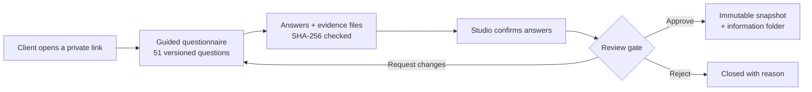

<p align="center">
  
</p>

<p align="center">
  
  
  
  
  
  
</p>

<p align="center"><b>English</b> · <a href="README.vi.md">Tiếng Việt</a> · <a href="docs/DEPLOY.md">Deploy</a> · <a href="SECURITY.md">Security</a></p>

## The problem

Every video ad starts the same way: a client sends a scattered brief over chat, files arrive in five formats, and nobody can say later *who agreed to what*. Re-shoots and "that's not what I asked for" follow.

**Video OS fixes the first mile.** Clients answer a guided questionnaire and attach their material; the studio confirms every answer, and a PM approves an immutable snapshot. Nothing moves to production until the brief is approved.

## How it works



## Features

| | |
|---|---|
| 🧭 **Guided intake** | 16 core + 35 branch questions on deliverables, language, timeline, budget, rights and AI usage. Clients fill it in themselves, including image, video, audio and reference uploads. |
| 🔎 **Evidence, not guesses** | Source files carry SHA-256 checksums that are re-verified on use. Prefill reads only explicitly marked answers (`CORE-02: …`) from TXT/MD/DOCX/PDF — no hidden inference, no LLM call. |
| ✅ **Review gate** | PM/Admin confirm, then approve, request changes or reject a canonical-JSON snapshot. Editing after approval marks it historical and blocks hand-off. |
| 📦 **Exports** | Information folder as ZIP with a checksummed manifest, plus JSON, DOCX, PDF and Excel working sheets. |
| 🔐 **Roles and tenants** | `ADMIN`, `PM`, `ACCOUNT`, `VIEWER`, enforced on the server and isolated per tenant. |
| 🎬 **Cinematic front end** | Scroll-driven WebGL chapters, an aperture opening transition, 3D scenes and torn-paper sections. |

## Tech stack

| Layer | Choice |
|---|---|
| Front end | Next.js 16 · React 19 · TypeScript · three.js |
| Back end | FastAPI · SQLAlchemy 2 · Alembic · Pydantic 2 |
| Data | PostgreSQL 17 (SQLite for tests) · local file storage with checksums |
| Exports | python-docx · ReportLab · openpyxl |
| Ops | Docker Compose (local DB) · Render Blueprint (`render.yaml`) |

## Quick start

Requirements: Python 3.11+, Node.js compatible with Next.js 16, npm, Docker Desktop (for PostgreSQL).

```powershell
python scripts/manage.py setup      # venv, locked dependencies, PostgreSQL, migrations, owner account
python scripts/manage.py start      # API :8100, web :3100
```

Open <http://127.0.0.1:3100>. The owner credentials are generated at bootstrap into a local, git-ignored file — there are no default accounts or passwords in the source. On Windows, `CAP-NHAT-VA-CHAY.bat` rebuilds and starts everything and `DUNG-UNG-DUNG.bat` stops it.

<details>
<summary><b>Configuration</b></summary>

Copy `.env.example` to `.env` and set real values. Never commit `.env`.

| Variable | Purpose | Default |
|---|---|---|
| `DATABASE_URL` | PostgreSQL connection string | — (required) |
| `STORAGE_DIR` | Where uploaded source files live | `./runtime/storage` |
| `APP_ENV` | `production` enables secure cookies and HSTS and hides API docs | `development` |
| `COOKIE_SECURE` | Force the `Secure` flag on the session cookie | `true` in production |
| `TRUST_PROXY` | Trust `X-Forwarded-For` (only behind a proxy you control) | `false` |
| `BACKEND_URL` | (front end) API address for the `/api` proxy | `http://127.0.0.1:8100` |
| `PDF_FONT_PATH` | Unicode font for PDF export | system default |

</details>

<details>
<summary><b>Tests</b></summary>

```powershell
.\.venv\Scripts\python.exe -m pytest
cd frontend; npm run typecheck; npm run build
```

Pytest uses an isolated temporary SQLite database and never touches real data.

</details>

## Architecture

```
 Browser ──HTTPS──▶ Next.js (UI, security headers, same-origin /api proxy)
                          │
                          ▼
                    FastAPI (auth, validation, review, export)
                    │                        │
                    ▼                        ▼
             PostgreSQL                Local file storage
        (SQLAlchemy + Alembic)       (UUID names + checksums)
```

| Path | Purpose |
|---|---|
| `backend/` | FastAPI app, models, validation, parsing, review/snapshot/export, migrations |
| `frontend/` | Next.js / TypeScript UI and three.js scenes |
| `tests/` | Integration tests with isolated QA data |
| `scripts/` | Launcher (`manage.py`), bootstrap, verification helpers |
| `docs/` | Decisions, contracts, scope, deployment guide |
| `render.yaml` · `compose.yaml` | Online blueprint · local PostgreSQL |

## Security

Security is part of the design. Highlights (full detail in [SECURITY.md](SECURITY.md)):

- PBKDF2-HMAC-SHA256 with 600 000 rounds and per-user salt; constant-time checks, and unknown usernames cost the same time as known ones.
- Server-side sessions; `HttpOnly`, `SameSite=Strict` and `Secure` cookies; a CSRF token on every state-changing request.
- Login throttling per IP and username; rate-limited public intake endpoint; per-link upload caps.
- Strict per-tenant isolation and server-side authorization on every route.
- Uploads validated by extension, size per media type and file signature, stored under random UUID names.
- Security headers on both layers (nosniff, frame denial, referrer and permissions policy, HSTS in production); CSP ships in report-only mode first.
- Append-only audit trail; passwords are never logged.

## Deploy online

`render.yaml` provisions PostgreSQL, the API and the web app in one step. The step-by-step guide with a pre-publication checklist is in [docs/DEPLOY.md](docs/DEPLOY.md).

## Roadmap

- [x] **Stage 01 — Information gate:** intake, evidence, review, exports
- [ ] Client self-registration with admin approve / block / delete
- [ ] Separate client and staff front ends
- [ ] Per-scene attachments and brand kit (colours, logo)
- [ ] Later stages: generation, rendering, delivery (out of scope for now)

## Third-party assets and license

Source code: [MIT](LICENSE). Some bundled 3D scenes and textures under `frontend/public/renaissance/` come from a third party and are **not** covered by that licence — replace them with your own before redistributing or deploying publicly ([NOTICE.md](NOTICE.md)).
