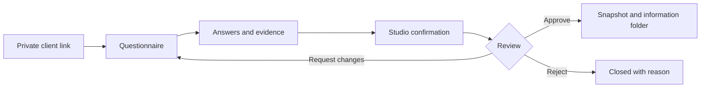
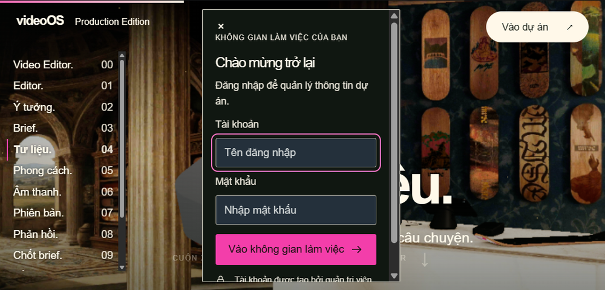
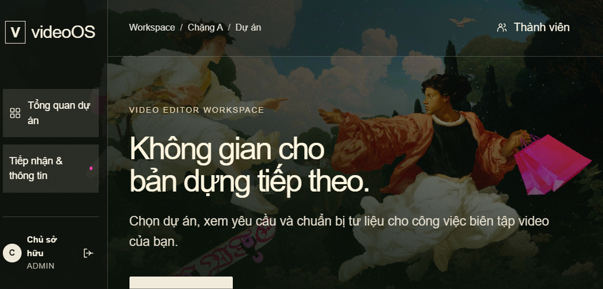

<div align="center">


# videoOS

**Client intake and information gate for video-ad studios.**<br>
Collect the brief, verify the evidence, approve it once — before production starts.


[English](README.md) · [Tiếng Việt](README.vi.md) · [Deployment](docs/DEPLOY.md) · [Security](SECURITY.md)

<br>


</div>

<br>

## Contents

- [Overview](#overview)
- [Features](#features)
- [Screenshots](#screenshots)
- [Getting started](#getting-started)
- [Configuration](#configuration)
- [Architecture](#architecture)
- [Security](#security)
- [Deployment](#deployment)
- [Roadmap](#roadmap)
- [License](#license)

## Overview

videoOS replaces the scattered first step of a video-ad project — briefs sent over chat, files in mixed formats, unclear sign-off — with one auditable workflow. Clients answer a guided questionnaire and attach their material, the studio confirms each answer, and a project manager approves an immutable snapshot. Nothing is handed to production until that snapshot is approved.



## Features

- **Structured intake.** 51 versioned questions (16 core, 35 branch) covering deliverables, language, timeline, budget, rights and AI usage. Clients can upload images, video, audio and reference files themselves.
- **Verifiable evidence.** Every source file is stored with a SHA-256 checksum that is re-verified on use. Prefill reads only explicitly marked answers (`CORE-02: …`) from TXT, MD, DOCX and PDF; nothing is inferred and no LLM is called.
- **Review gate.** Admins and PMs confirm answers, then approve, request changes or reject a canonical-JSON snapshot. Editing after approval marks the snapshot historical and blocks hand-off.
- **Exports.** Information folder as ZIP with a checksummed manifest; JSON, DOCX, PDF and Excel working sheets.
- **Access control.** Roles `ADMIN`, `PM`, `ACCOUNT` and `VIEWER`, enforced on the server and isolated per tenant.
- **Scroll-driven interface.** WebGL chapters built with three.js, with an aperture opening transition.

## Screenshots

<table>
  <tr>
    <td width="33%"></td>
    <td width="33%"></td>
    <td width="33%"></td>
  </tr>
  <tr align="center">
    <td>Opening</td>
    <td>Sign-in</td>
    <td>Workspace</td>
  </tr>
</table>

## Getting started

**Requirements:** Python 3.11+, Node.js compatible with Next.js 16, npm, Docker Desktop (for PostgreSQL).

```powershell
python scripts/manage.py setup    # virtualenv, locked dependencies, PostgreSQL, migrations, owner account
python scripts/manage.py start    # API on :8100, web on :3100
```

Open <http://127.0.0.1:3100>. Owner credentials are generated during setup and written to a local, git-ignored file; the repository contains no default accounts or passwords.

On Windows, `CAP-NHAT-VA-CHAY.bat` rebuilds and starts everything, and `DUNG-UNG-DUNG.bat` stops it.

**Tests**

```powershell
.\.venv\Scripts\python.exe -m pytest
cd frontend; npm run typecheck; npm run build
```

Pytest uses an isolated temporary SQLite database and never touches real data.

## Configuration

Copy `.env.example` to `.env` and set real values. Never commit `.env`.

| Variable | Description | Default |
|---|---|---|
| `DATABASE_URL` | PostgreSQL connection string | required |
| `STORAGE_DIR` | Directory for uploaded source files | `./runtime/storage` |
| `APP_ENV` | `production` enables secure cookies and HSTS and hides API docs | `development` |
| `COOKIE_SECURE` | Force the `Secure` flag on the session cookie | `true` in production |
| `TRUST_PROXY` | Trust `X-Forwarded-For` (only behind a proxy you control) | `false` |
| `BACKEND_URL` | Front end: API address used by the `/api` proxy | `http://127.0.0.1:8100` |
| `PDF_FONT_PATH` | Unicode font for PDF export | system default |

## Architecture

The browser talks to a single origin. Next.js serves the UI and proxies `/api/v1/*` to FastAPI, which owns authentication, validation, review and export.

| Component | Technology | Responsibility |
|---|---|---|
| `frontend/` | Next.js 16, React 19, TypeScript, three.js | UI, 3D scenes, security headers, API proxy |
| `backend/` | FastAPI, SQLAlchemy 2, Alembic, Pydantic 2 | Auth, validation, review, snapshots, exports |
| Database | PostgreSQL 17 (SQLite in tests) | Projects, answers, audit trail |
| File storage | Local disk | Uploads under UUID names with checksums |

```
backend/      API, models, migrations
frontend/     web application
tests/        integration tests (isolated QA data)
scripts/      launcher, bootstrap, verification helpers
docs/         decisions, contracts, deployment guide
render.yaml   online deployment blueprint
compose.yaml  local PostgreSQL
```

## Security

Details and the reporting process are in [SECURITY.md](SECURITY.md).

- Passwords: PBKDF2-HMAC-SHA256, 600,000 rounds, per-user salt; constant-time verification, with equal cost for unknown usernames.
- Sessions: server-side; `HttpOnly`, `SameSite=Strict` and (in production) `Secure` cookies; CSRF token on every state-changing request.
- Abuse limits: login throttling per IP and username, rate-limited public intake, per-link upload caps.
- Isolation: per-tenant data separation and server-side authorization on every route.
- Uploads: validated by extension, per-type size limit and file signature; stored under random UUID names.
- Headers: nosniff, frame denial, referrer and permissions policy, HSTS in production; CSP ships in report-only mode first.
- Audit: append-only event log; passwords are never logged.

## Deployment

`render.yaml` provisions PostgreSQL, the API and the web application on Render. The full procedure, with a pre-publication checklist and post-deploy checks, is in [docs/DEPLOY.md](docs/DEPLOY.md).

## Roadmap

- [x] Stage 01: information gate — intake, evidence, review, exports
- [ ] Client self-registration with admin approve, block and delete
- [ ] Separate client and staff front ends
- [ ] Per-scene attachments and brand kit (colours, logo)
- [ ] Later stages: generation, rendering, delivery

## License

Source code is released under the [MIT License](LICENSE).

Some 3D scenes and textures in `frontend/public/renaissance/` come from a third party and are **not** covered by that license. Replace them with your own assets before redistributing or deploying publicly. See [NOTICE.md](NOTICE.md).
