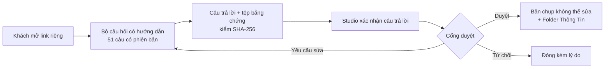

<p align="center">
  
</p>

<p align="center">
  
  
  
  
  
  
</p>

<p align="center"><a href="README.md">English</a> · <b>Tiếng Việt</b> · <a href="docs/DEPLOY.md">Triển khai</a> · <a href="SECURITY.md">Bảo mật</a></p>

## Vấn đề

Dự án quảng cáo nào cũng bắt đầu giống nhau: khách gửi yêu cầu rời rạc qua tin nhắn, tệp đến dưới năm định dạng, và về sau không ai nói chắc được *ai đã đồng ý điều gì*. Kết quả là quay lại, dựng lại và câu "không phải cái tôi cần".

**Video OS giải quyết chặng đầu tiên.** Khách trả lời bộ câu hỏi có hướng dẫn và đính kèm tư liệu; studio xác nhận từng câu trả lời, rồi quản lý duyệt một bản chụp không thể sửa. Chưa duyệt brief thì chưa sang sản xuất.

## Cách hoạt động



## Tính năng

| | |
|---|---|
| 🧭 **Tiếp nhận có hướng dẫn** | 16 câu lõi + 35 câu theo nhánh về sản phẩm bàn giao, ngôn ngữ, tiến độ, ngân sách, bản quyền và việc dùng AI. Khách tự điền, kể cả tải ảnh, video, âm thanh, tệp mẫu. |
| 🔎 **Bằng chứng, không đoán** | Tệp nguồn có checksum SHA-256, kiểm lại khi dùng. Prefill chỉ đọc các dòng đánh dấu rõ (`CORE-02: …`) từ TXT/MD/DOCX/PDF — không suy đoán ngầm, không gọi LLM. |
| ✅ **Cổng duyệt** | PM/Admin xác nhận, rồi duyệt, yêu cầu sửa hoặc từ chối một bản chụp JSON chuẩn hóa. Sửa sau khi duyệt sẽ đánh dấu bản cũ là lịch sử và chặn bàn giao. |
| 📦 **Xuất tệp** | Folder Thông Tin dạng ZIP kèm manifest có checksum, cùng JSON, DOCX, PDF và các bảng Excel làm việc. |
| 🔐 **Vai trò và tenant** | `ADMIN`, `PM`, `ACCOUNT`, `VIEWER`, kiểm tra ở máy chủ và cô lập theo từng tenant. |
| 🎬 **Giao diện điện ảnh** | Chương cuộn WebGL, hiệu ứng mở màn khẩu độ, cảnh 3D và các mảng giấy xé. |

## Công nghệ

| Tầng | Lựa chọn |
|---|---|
| Giao diện | Next.js 16 · React 19 · TypeScript · three.js |
| Máy chủ | FastAPI · SQLAlchemy 2 · Alembic · Pydantic 2 |
| Dữ liệu | PostgreSQL 17 (SQLite khi test) · lưu tệp cục bộ kèm checksum |
| Xuất tệp | python-docx · ReportLab · openpyxl |
| Vận hành | Docker Compose (DB cục bộ) · Render Blueprint (`render.yaml`) |

## Chạy nhanh

Yêu cầu: Python 3.11+, Node.js tương thích Next.js 16, npm, Docker Desktop (cho PostgreSQL).

```powershell
python scripts/manage.py setup      # venv, thư viện khóa phiên bản, PostgreSQL, migration, tài khoản chủ
python scripts/manage.py start      # API :8100, web :3100
```

Mở <http://127.0.0.1:3100>. Tài khoản chủ được tạo lúc bootstrap vào file cục bộ không đưa lên git; mã nguồn không có tài khoản hay mật khẩu mặc định. Trên Windows dùng `CAP-NHAT-VA-CHAY.bat` để dựng lại và chạy, `DUNG-UNG-DUNG.bat` để dừng.

<details>
<summary><b>Cấu hình</b></summary>

Sao chép `.env.example` thành `.env` và điền giá trị thật. Không commit `.env`.

| Biến | Công dụng | Mặc định |
|---|---|---|
| `DATABASE_URL` | Chuỗi kết nối PostgreSQL | — (bắt buộc) |
| `STORAGE_DIR` | Nơi lưu tệp khách tải lên | `./runtime/storage` |
| `APP_ENV` | `production` bật cookie bảo mật, HSTS và ẩn tài liệu API | `development` |
| `COOKIE_SECURE` | Ép cờ `Secure` cho cookie phiên | `true` khi production |
| `TRUST_PROXY` | Tin `X-Forwarded-For` (chỉ khi sau proxy do bạn kiểm soát) | `false` |
| `BACKEND_URL` | (giao diện) Địa chỉ API cho proxy `/api` | `http://127.0.0.1:8100` |
| `PDF_FONT_PATH` | Font Unicode để xuất PDF | font hệ thống |

</details>

<details>
<summary><b>Kiểm thử</b></summary>

```powershell
.\.venv\Scripts\python.exe -m pytest
cd frontend; npm run typecheck; npm run build
```

Pytest dùng SQLite tạm, không đụng dữ liệu thật.

</details>

## Kiến trúc

```
 Trình duyệt ──HTTPS──▶ Next.js (giao diện, header bảo mật, proxy /api cùng nguồn)
                              │
                              ▼
                        FastAPI (xác thực, kiểm tra, duyệt, xuất tệp)
                        │                        │
                        ▼                        ▼
                 PostgreSQL                 Lưu tệp cục bộ
            (SQLAlchemy + Alembic)        (tên UUID + checksum)
```

| Đường dẫn | Nội dung |
|---|---|
| `backend/` | Ứng dụng FastAPI, model, kiểm tra, phân tích tệp, duyệt/bản chụp/xuất, migration |
| `frontend/` | Giao diện Next.js / TypeScript và cảnh three.js |
| `tests/` | Kiểm thử tích hợp với dữ liệu QA cô lập |
| `scripts/` | Trình chạy (`manage.py`), bootstrap, công cụ kiểm tra |
| `docs/` | Quyết định, hợp đồng, phạm vi, hướng dẫn triển khai |
| `render.yaml` · `compose.yaml` | Blueprint online · PostgreSQL cục bộ |

## Bảo mật

Bảo mật nằm trong thiết kế. Tóm tắt (chi tiết ở [SECURITY.md](SECURITY.md)):

- Băm mật khẩu PBKDF2-HMAC-SHA256 600.000 vòng, salt riêng từng người; so sánh thời gian cố định, tên đăng nhập không tồn tại cũng tốn thời gian như tồn tại.
- Phiên phía máy chủ; cookie `HttpOnly`, `SameSite=Strict`, `Secure`; token CSRF cho mọi thao tác ghi.
- Giới hạn đăng nhập sai theo IP và tên; giới hạn tốc độ ở trang tiếp nhận công khai; giới hạn tải lên theo từng link.
- Cô lập dữ liệu chặt theo tenant, kiểm quyền ở máy chủ trên mọi route.
- Kiểm tệp tải lên theo đuôi, dung lượng từng loại và chữ ký tệp; lưu dưới tên UUID ngẫu nhiên.
- Header bảo mật ở cả hai tầng (nosniff, chặn nhúng khung, chính sách referrer và quyền, HSTS khi production); CSP chạy chế độ báo cáo trước.
- Nhật ký kiểm toán chỉ ghi thêm; không ghi mật khẩu vào log.

## Triển khai online

`render.yaml` dựng sẵn PostgreSQL, API và web trong một bước. Hướng dẫn từng bước kèm danh sách việc cần làm trước khi công khai nằm ở [docs/DEPLOY.md](docs/DEPLOY.md).

## Lộ trình

- [x] **Chặng 01 — Cổng thông tin:** tiếp nhận, bằng chứng, duyệt, xuất tệp
- [ ] Khách tự đăng ký, admin duyệt / chặn / xóa
- [ ] Tách giao diện cho khách và nhân viên
- [ ] Tệp đính kèm theo từng cảnh và bộ nhận diện thương hiệu (màu, logo)
- [ ] Các chặng sau: sinh nội dung, dựng, bàn giao (chưa nằm trong phạm vi)

## Tài nguyên bên thứ ba và giấy phép

Mã nguồn theo giấy phép [MIT](LICENSE). Một số cảnh 3D và texture trong `frontend/public/renaissance/` có nguồn từ bên thứ ba, **không** thuộc giấy phép đó — hãy thay bằng tài nguyên của bạn trước khi công khai hoặc triển khai ([NOTICE.md](NOTICE.md)).
