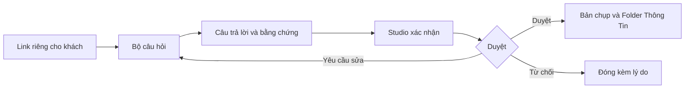
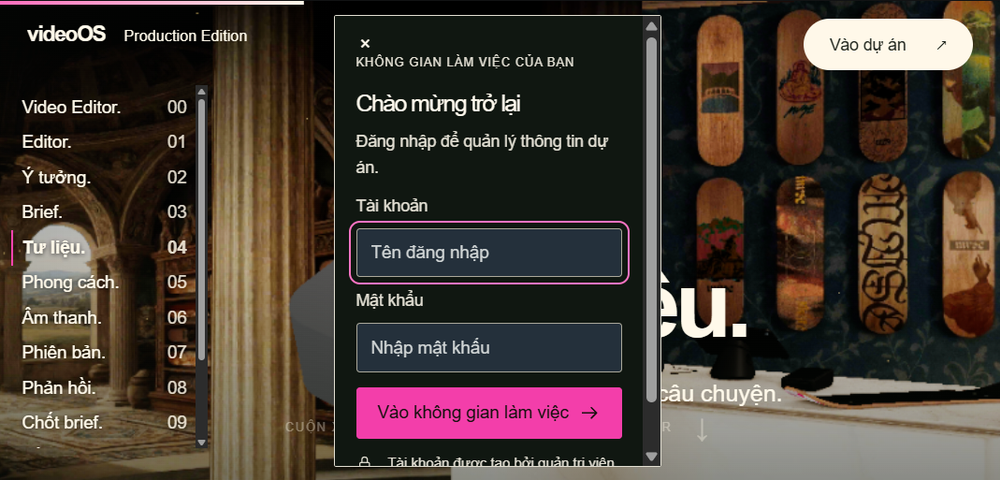
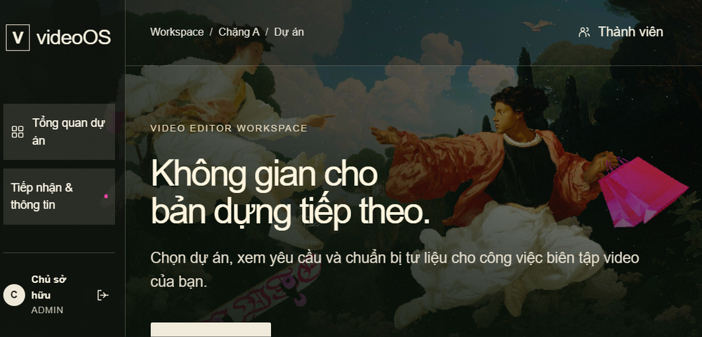

<div align="center">


# videoOS

**Cổng tiếp nhận khách hàng và thông tin cho studio làm video quảng cáo.**<br>
Thu thập brief, kiểm chứng bằng chứng, duyệt một lần — trước khi bắt đầu sản xuất.


[English](README.md) · [Tiếng Việt](README.vi.md) · [Triển khai](docs/DEPLOY.md) · [Bảo mật](SECURITY.md)

<br>


</div>

<br>

## Mục lục

- [Tổng quan](#tổng-quan)
- [Tính năng](#tính-năng)
- [Ảnh chụp màn hình](#ảnh-chụp-màn-hình)
- [Bắt đầu](#bắt-đầu)
- [Cấu hình](#cấu-hình)
- [Kiến trúc](#kiến-trúc)
- [Bảo mật](#bảo-mật)
- [Triển khai](#triển-khai)
- [Lộ trình](#lộ-trình)
- [Giấy phép](#giấy-phép)

## Tổng quan

videoOS thay bước đầu rời rạc của một dự án quảng cáo — brief gửi qua tin nhắn, tệp nhiều định dạng, không rõ ai đã đồng ý — bằng một quy trình duy nhất, truy vết được. Khách trả lời bộ câu hỏi có hướng dẫn và đính kèm tư liệu, studio xác nhận từng câu trả lời, rồi quản lý dự án duyệt một bản chụp không thể sửa. Chưa duyệt bản chụp này thì chưa bàn giao sang sản xuất.



## Tính năng

- **Tiếp nhận có cấu trúc.** 51 câu hỏi có phiên bản (16 câu lõi, 35 câu theo nhánh) về sản phẩm bàn giao, ngôn ngữ, tiến độ, ngân sách, bản quyền và việc dùng AI. Khách tự tải ảnh, video, âm thanh và tệp mẫu lên.
- **Bằng chứng kiểm chứng được.** Mỗi tệp nguồn được lưu kèm checksum SHA-256 và kiểm lại khi dùng. Prefill chỉ đọc các câu trả lời đánh dấu rõ (`CORE-02: …`) từ TXT, MD, DOCX và PDF; không suy đoán và không gọi LLM.
- **Cổng duyệt.** Admin và PM xác nhận câu trả lời, rồi duyệt, yêu cầu sửa hoặc từ chối một bản chụp JSON chuẩn hóa. Sửa sau khi duyệt sẽ đánh dấu bản chụp là lịch sử và chặn bàn giao.
- **Xuất tệp.** Folder Thông Tin dạng ZIP kèm manifest có checksum; JSON, DOCX, PDF và các bảng Excel làm việc.
- **Phân quyền.** Vai trò `ADMIN`, `PM`, `ACCOUNT`, `VIEWER`, kiểm tra ở máy chủ và cô lập theo từng tenant.
- **Giao diện cuộn theo trang.** Các chương WebGL dựng bằng three.js, có hiệu ứng mở màn khẩu độ.

## Ảnh chụp màn hình

<table>
  <tr>
    <td width="33%"></td>
    <td width="33%"></td>
    <td width="33%"></td>
  </tr>
  <tr align="center">
    <td>Mở màn</td>
    <td>Đăng nhập</td>
    <td>Không gian làm việc</td>
  </tr>
</table>

## Bắt đầu

**Yêu cầu:** Python 3.11+, Node.js tương thích Next.js 16, npm, Docker Desktop (cho PostgreSQL).

```powershell
python scripts/manage.py setup    # virtualenv, thư viện khóa phiên bản, PostgreSQL, migration, tài khoản chủ
python scripts/manage.py start    # API tại :8100, web tại :3100
```

Mở <http://127.0.0.1:3100>. Thông tin tài khoản chủ được tạo khi cài đặt và ghi vào một file cục bộ không đưa lên git; kho mã không chứa tài khoản hay mật khẩu mặc định.

Trên Windows, `CAP-NHAT-VA-CHAY.bat` dựng lại và chạy toàn bộ, `DUNG-UNG-DUNG.bat` để dừng.

**Kiểm thử**

```powershell
.\.venv\Scripts\python.exe -m pytest
cd frontend; npm run typecheck; npm run build
```

Pytest dùng SQLite tạm, không đụng dữ liệu thật.

## Cấu hình

Sao chép `.env.example` thành `.env` và điền giá trị thật. Không commit `.env`.

| Biến | Mô tả | Mặc định |
|---|---|---|
| `DATABASE_URL` | Chuỗi kết nối PostgreSQL | bắt buộc |
| `STORAGE_DIR` | Thư mục lưu tệp khách tải lên | `./runtime/storage` |
| `APP_ENV` | `production` bật cookie bảo mật, HSTS và ẩn tài liệu API | `development` |
| `COOKIE_SECURE` | Ép cờ `Secure` cho cookie phiên | `true` khi production |
| `TRUST_PROXY` | Tin `X-Forwarded-For` (chỉ khi sau proxy do bạn kiểm soát) | `false` |
| `BACKEND_URL` | Giao diện: địa chỉ API cho proxy `/api` | `http://127.0.0.1:8100` |
| `PDF_FONT_PATH` | Font Unicode để xuất PDF | font hệ thống |

## Kiến trúc

Trình duyệt chỉ làm việc với một nguồn duy nhất. Next.js phục vụ giao diện và chuyển tiếp `/api/v1/*` tới FastAPI, nơi xử lý xác thực, kiểm tra, duyệt và xuất tệp.

| Thành phần | Công nghệ | Nhiệm vụ |
|---|---|---|
| `frontend/` | Next.js 16, React 19, TypeScript, three.js | Giao diện, cảnh 3D, header bảo mật, proxy API |
| `backend/` | FastAPI, SQLAlchemy 2, Alembic, Pydantic 2 | Xác thực, kiểm tra, duyệt, bản chụp, xuất tệp |
| Cơ sở dữ liệu | PostgreSQL 17 (SQLite khi test) | Dự án, câu trả lời, nhật ký kiểm toán |
| Lưu tệp | Ổ đĩa cục bộ | Tệp tải lên dưới tên UUID kèm checksum |

```
backend/      API, model, migration
frontend/     ứng dụng web
tests/        kiểm thử tích hợp (dữ liệu QA cô lập)
scripts/      trình chạy, bootstrap, công cụ kiểm tra
docs/         quyết định, hợp đồng, hướng dẫn triển khai
render.yaml   bản thiết kế triển khai online
compose.yaml  PostgreSQL cục bộ
```

## Bảo mật

Chi tiết và cách báo lỗi bảo mật nằm ở [SECURITY.md](SECURITY.md).

- Mật khẩu: PBKDF2-HMAC-SHA256, 600.000 vòng, salt riêng từng người; kiểm tra thời gian cố định, tên đăng nhập không tồn tại cũng tốn thời gian như tồn tại.
- Phiên: lưu phía máy chủ; cookie `HttpOnly`, `SameSite=Strict` và `Secure` khi production; token CSRF cho mọi thao tác ghi.
- Giới hạn lạm dụng: chặn đăng nhập sai theo IP và tên, giới hạn tốc độ trang tiếp nhận công khai, giới hạn tải lên theo từng link.
- Cô lập: tách dữ liệu theo tenant, kiểm quyền ở máy chủ trên mọi route.
- Tệp tải lên: kiểm theo đuôi, dung lượng từng loại và chữ ký tệp; lưu dưới tên UUID ngẫu nhiên.
- Header: nosniff, chặn nhúng khung, chính sách referrer và quyền, HSTS khi production; CSP chạy chế độ báo cáo trước.
- Kiểm toán: nhật ký sự kiện chỉ ghi thêm; không ghi mật khẩu vào log.

## Triển khai

`render.yaml` dựng PostgreSQL, API và ứng dụng web trên Render. Quy trình đầy đủ, kèm danh sách kiểm tra trước khi công khai và sau khi lên mạng, nằm ở [docs/DEPLOY.md](docs/DEPLOY.md).

## Lộ trình

- [x] Chặng 01: cổng thông tin — tiếp nhận, bằng chứng, duyệt, xuất tệp
- [ ] Khách tự đăng ký, admin duyệt, chặn và xóa
- [ ] Tách giao diện cho khách và nhân viên
- [ ] Tệp đính kèm theo từng cảnh và bộ nhận diện thương hiệu (màu, logo)
- [ ] Các chặng sau: sinh nội dung, dựng, bàn giao

## Giấy phép

Mã nguồn phát hành theo [giấy phép MIT](LICENSE).

Một số cảnh 3D và texture trong `frontend/public/renaissance/` có nguồn từ bên thứ ba và **không** thuộc giấy phép đó. Hãy thay bằng tài nguyên của bạn trước khi công khai hoặc triển khai. Xem [NOTICE.md](NOTICE.md).
